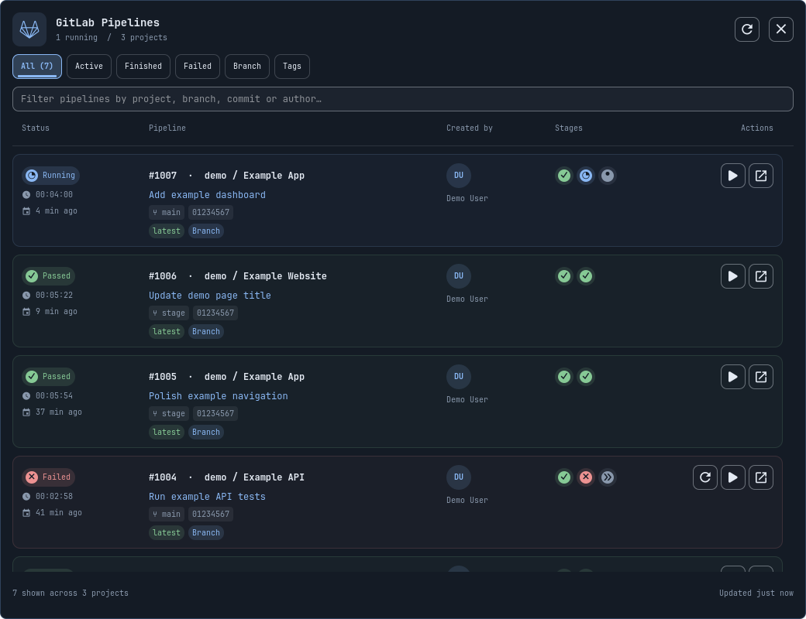

# GitLab Pipelines for Omarchy

One GitLab-style pipeline list across your member projects. It uses Omarchy's active theme, font, UI scale, outlined controls, accent icon header, and subtly tinted cards with rounded borders. The aligned columns retain GitLab's familiar structure: status and duration, pipeline ID and project, commit title, branch or tag and SHA, author initials, stage indicators, and a link to the run. English and German labels follow Omarchy's language setting.



Both preview images are rendered offscreen from the fictional fixtures in `tools/render_preview.py`. They contain no account screenshots, real project names, pipeline IDs, commits, or user photos.

The overview includes explicit pipeline and job actions. The tabs filter all, active, finished, failed, branch, or tag runs. Search matches project, commit, branch, author, status, and pipeline ID. Click the ID or arrow to open the run in GitLab. The latest pipeline for each project/ref in the fetched list gets a "latest" badge. Stage tooltips show stage names and status. Author photos are cached locally; initials appear until a photo loads or when it is unavailable. Analytics, runner-cache management, and unrelated GitLab inbox features are omitted.

## Requirements and installation

Requires Omarchy 4 (Quattro) with its Quickshell plugin system, Python 3, and Git for installation and updates. Qt Quick/Controls, Quickshell, and the Omarchy shell imports come with Omarchy. GitLab CLI (`glab`) is optional: if present, the plugin can delegate authenticated API calls to it. Otherwise it calls GitLab directly using Python's standard library. No pip packages, Node, server, or database are needed.

Install from this repository with Omarchy's plugin manager:

```sh
omarchy plugin add https://github.com/ianzano/omarchy-gitlab.git --enable
```

The plugin manager asks for consent before installation and enabling. The widget defaults to the right bar section. It runs inside Omarchy's unsandboxed shell and makes HTTPS requests to your configured GitLab host and, for permitted avatar URLs, Gravatar. Review the source before enabling it.

Update a Git-managed installation:

```sh
omarchy plugin update ianzano.pipelines
```

For development or a local-copy installation:

```sh
git clone https://github.com/ianzano/omarchy-gitlab.git
cd omarchy-gitlab
python3 install.py
```

Running the local installer explicitly installs and enables the widget. It copies the runtime files and license to `~/.config/omarchy/plugins/ianzano.pipelines/`, rescans, and enables the widget. It backs up existing plugin files and bar configuration on reinstall. No packaged Omarchy files are modified. Reinstall after changing the source checkout; local-copy installations do not support `omarchy plugin update`.

## Disable and remove

```sh
omarchy plugin disable ianzano.pipelines
omarchy plugin remove ianzano.pipelines
```

Removal asks for confirmation, unloads the plugin, and removes its installed directory (or backs it up for a local-copy installation). Credentials and caches remain outside that directory. To forget the saved plugin credentials and cached metadata/avatars as well, optionally remove these plugin-specific directories:

```sh
rm -rf -- "${XDG_CONFIG_HOME:-$HOME/.config}/omarchy/pipelines"
rm -rf -- "${XDG_CACHE_HOME:-$HOME/.cache}/omarchy/pipelines"
```

This does not revoke a GitLab token or remove credentials managed by `glab` or your environment. Revoke personal access tokens through GitLab when no longer needed. Installer backups remain under `~/.config/omarchy/plugin-backups/` and in timestamped `shell.json.bak.pipelines-*` files for recovery.

## Connect GitLab

Click the GitLab icon, then **Connect GitLab**. A terminal asks for a personal access token. Use **`api` scope** for Run/Retry actions; `read_api` enables viewing only. GitLab project permissions are still required. Input is hidden; the helper checks the token before saving it. Create a token at [GitLab's personal access token page](https://gitlab.com/-/user_settings/personal_access_tokens). Tokens are stored in `$XDG_CONFIG_HOME/omarchy/pipelines/<hostname>.token` (default `~/.config/omarchy/pipelines/gitlab.com.token`) as private files with mode `0600`. They are outside the source and installation directories. The token is never passed on the command line, rendered, or logged.

Alternatively, an existing `glab auth login --hostname gitlab.com` setup is reused, including glab's credential-store handling. A `GITLAB_TOKEN` or `GITLAB_ACCESS_TOKEN` inherited by the shell also works, scoped to `GITLAB_HOST` (GitLab.com by default). A saved plugin token takes priority. Remove that token file to return to glab authentication.

After connecting, reopen the panel. Authentication for your private account is required to see private projects; a screenshot does not grant API access.

## Scrolling, jobs, and actions

The list uses an ordinary Qt Quick Controls `ScrollView` and Qt's own wheel, high-resolution wheel, touchpad, and momentum handling. There is no custom wheel interceptor, fixed per-notch distance, delayed content animation, or overridden flick velocity/deceleration. The reading position survives data refreshes; changing a filter resets it.

The table uses the same fixed column widths for headers and cells. Avatar, stage, and action centers share one primary row; icon glyphs are centered by their painted bounds. Long branch labels elide inside their badges, and the scrollbar has a reserved gutter.

Click any stage circle to open a compact popover anchored to that circle, like GitLab's stage menus. The popover lists only that stage's jobs with compact Run/Retry controls; pipeline rows never expand. Click the same circle again, click outside, press Escape, or scroll the list to dismiss it. A `+`/ellipsis circle opens all jobs when stage indicators are truncated or unavailable. Job details load only on demand and are cached for 20 seconds. **Run** plays an eligible manual job; **Retry** reruns an eligible completed job, including successful jobs where GitLab permits it. The backend rechecks the selected job's state before writing. Up to 500 jobs are fetched, with a notice directing to GitLab when there are more.

The pipeline row has separate controls:

- **Retry** retries failed or canceled jobs in the existing pipeline, matching GitLab's pipeline retry operation.
- **Run again** creates a new pipeline on the latest branch/tag ref (or the merge request ref for MR pipelines). It uses default variables, rather than copying custom variables/inputs from an earlier run. Use GitLab for jobs or pipelines that require custom input values.
- **Open** opens the pipeline in GitLab.

An action runs only after a click. Successful actions invalidate the affected caches and refresh status. Writes share the same paced request budget and server cooldown as reads. Duplicate clicks across panels are suppressed. A timeout or lost confirmation is never automatically retried: the panel asks you to inspect GitLab before trying again. Tests exercise writes against a local synthetic GitLab service; no real pipelines are started by tests.

Avatar URLs arrive in the existing pipeline query, so no separate user lookup is needed. Photos are fetched once per unique URL and cached for 24 hours as private files; failed downloads are cached for 10 minutes. Downloads are at most 512 KiB, permit raster images only, do not follow redirects, and are restricted to the configured GitLab host and Gravatar. Credentials are sent only to the configured GitLab host. Avatar requests also respect the shared budget. QML reads only those cached local files, with a circular crop and initials fallback.

## Refresh and scope

The overview starts with the newest **20 pipelines**, merged across all projects where the account is a member, including inherited group membership. **Load 20 more** appears at the end of the list while older runs are available. It uses cached project pages and requests additional pages only from projects whose older runs could belong in the requested global window. Tabs and search apply to the loaded rows. The UI keeps up to 10,000 rows per view; the API still fetches pages of 20. Project discovery is paginated with an explicit limit of 2,000 member projects. Child-pipeline visibility follows GitLab's default pipeline connection behavior.

The helper maintains a private cache under `$XDG_CACHE_HOME/omarchy/pipelines/` (default `~/.cache/omarchy/pipelines/`). This contains pipeline metadata and project names, with mode `0600` in a `0700` directory; it contains no token. Its namespace includes the hostname and a credential fingerprint so a token change cannot reuse another account's snapshot. For glab, a config-file change invalidates the namespace. A file lock shares each refresh and request budget across monitors and helper processes. Snapshots and cooldowns survive closing the panel and shell restarts.

A normal refresh is no more frequent than once a minute, even with repeated opens, manual refresh clicks, or several monitors. Periodic refresh runs only while open. **Load more** may fetch older pages within that minute, but respects the same request budget and server cooldown. The project list is reused for 30 minutes. Stage queries batch up to eight displayed pipelines per HTTP request. Completed stages are reused for up to an hour when pipeline status and `updatedAt` match; active stages refresh at most once a minute. Changed pipelines invalidate their stage cache. There are at most 500 cached stage records.

All requests are sequential, spaced at least one second apart, with a shared rolling budget of **30 HTTP requests per minute** and a 110-second refresh deadline. GitLab's quota headers are checked after each response; five remaining requests trigger a protective pause. On HTTP 429, the helper stops the scan immediately, honors `Retry-After` / `RateLimit-Reset` with a safety margin, and persists that cooldown. Missing headers use exponential backoff starting at one minute. Refresh and Load more cannot override a cooldown. Existing rows stay visible with a notice and countdown. Other programs can consume the same GitLab quota, so this reduces the plugin's load and handles throttling; it cannot guarantee an account never reaches a server limit.

The first five stages are shown as circles. A `+` indicates more stages; open the pipeline for its full graph. Up to 16 stages are fetched per displayed run. No job logs or artifacts are downloaded. HTTPS requests do not follow redirects.

Configure hostname and refresh interval through Omarchy's bar widget settings, or:

```sh
omarchy bar set ianzano.pipelines hostname gitlab.com
omarchy bar set ianzano.pipelines refreshIntervalSec 60
```

Set the interval to `0` to disable periodic refresh. The minimum positive interval is 60 seconds. Use a hostname, optionally with a port, without `https://` or a path. Changing the host requires credentials for that host.

Keyboard controls: `/` focuses search; `j`/`k` or arrows select a pipeline; Enter opens it; `r` refreshes; Escape dismisses. In search, Escape clears the filter first and then returns keyboard focus to the list.

## Validation

```sh
omarchy plugin validate .
python3 -m unittest discover -s tests -v
python3 tools/render_preview.py
python3 tools/test_panel.py
python3 tools/test_interactions.py
python3 tools/test_native_scroll.py
```

Backend integration tests run the real HTTP client against a temporary localhost server and cover paginated discovery, merged ordering, partial access failures, unknown stages, HTTP errors, GraphQL errors, redirects, timeout budgets, token-file permissions, and host scoping. Additional HTTP tests cover shared monitor refreshes, persisted cooldowns, header-based quota protection, credential-isolated caches, completed-stage reuse, global Load more pagination, and local request budgets. The preview script loads the actual list component offscreen and checks status/branch/tag filters, latest badges, literal rendering of markup-shaped titles, and a live change from a dark theme to a light theme. The native-host test requires a Wayland session and tests process results, lazy content, error recovery, host changes, the 20-row Load more flow, and cooldown enforcement with a synthetic helper. No automated test contacts private projects or requires credentials. The interaction harness also verifies native flick momentum, exact header/cell and icon-center alignment, long-branch clipping, decoded cached avatars, anchored stage popovers, stage filtering and fixed row heights, action wiring, cooldown controls, and plain-text rendering of job names.

API contracts: [GitLab GraphQL queries](https://docs.gitlab.com/api/graphql/reference/queries/) and [objects](https://docs.gitlab.com/api/graphql/reference/objects/). Only explicit action clicks send mutations; opening, refreshing, loading more, expanding jobs, and loading avatars perform reads.

The native scrolling test injects real Qt wheel events into both the plugin list and an unmodified Qt `ScrollView`/`ListView`, comparing normal notches, high-resolution wheel packets, and flick physics. Native animation comparisons allow small frame-timing differences. This verifies the Qt input path; the perceived feel still depends on the input device and desktop input settings.

## License

Released under the [MIT License](LICENSE). GitLab is a trademark of GitLab Inc.; this is an independent community plugin and is not affiliated with or endorsed by GitLab.
